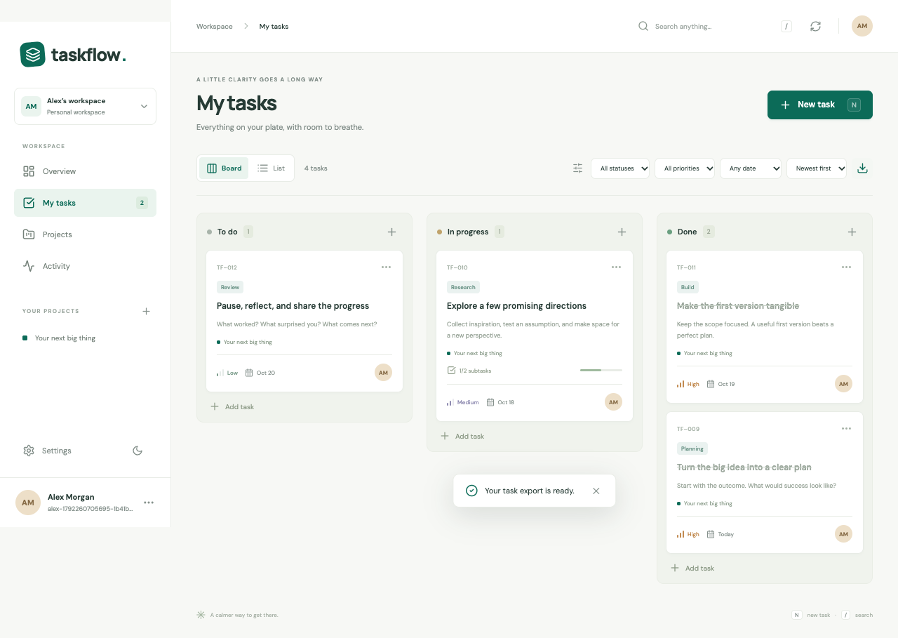

# TaskFlow

A focused project workspace for turning plans into finished work. Built with React, TypeScript, Spring Boot, PostgreSQL, and an API gateway.

Private accounts · Project dashboards · Kanban and list views · Priorities and due dates · Labels and subtasks · Notes and activity · CSV exports · Responsive layouts · Dark mode



The application and PostgreSQL deployment have been verified locally. Public hosting is ready to configure; no Azure resources or public URL have been created yet. See [verification and remaining setup](PROGRESS.md).

## Start with Docker

Install Docker Desktop, or Docker Engine with Compose v2, and start it. From the repository root:

```sh
python3 scripts/setup.py
docker compose up -d --build --wait --wait-timeout 300
python3 scripts/smoke.py http://localhost:8088 --wait-seconds 60
```

Open **http://localhost:8088** and create your account. Setup generates private database passwords without overwriting an existing `.env`. There are no shared demo credentials. You can optionally add an editable sample project inside the workspace.

Normal restarts and `docker compose down` preserve your databases. `docker compose down -v` deletes database volumes.

## Develop locally

Install Java 17, Maven, Python 3, and Node 22:

```sh
cd frontend
npm ci
cd ..
python3 scripts/dev.py
```

Open http://127.0.0.1:5173. Development uses persistent H2 databases in `.local-data/`; container deployments use PostgreSQL. Service logs are in `.local-logs/`. The launcher selects the installed Temurin 17 JDK on macOS when available and stops its child processes when you exit.

## Deploy publicly

Follow [the deployment guide](deployment/README.md). It includes Azure infrastructure, HTTPS, immutable source releases, startup rollback, Azure DevOps CI/CD, and backup/restoration commands.

Azure DevOps runs the pipeline. An **Azure subscription or another Linux server** is needed to host the app. The supplied Azure template provisions a VM with a public DNS hostname; a separately purchased domain is optional.

## Verify changes

```sh
mvn -f backend/pom.xml clean verify
python3 -m unittest discover -s scripts/tests -v
cd frontend
npm ci
npm run build
npm test
npx playwright install chromium
npm run test:e2e
```

Select Java 17 explicitly if Maven defaults to another JDK. Browser tests normally start the local app. To exercise a running Docker deployment instead:

```sh
TASKFLOW_BASE_URL=http://127.0.0.1:8088 npm run test:e2e
```

Verification includes 24 backend tests, 3 frontend utility tests, 9 deployment/infrastructure checks, and 4 browser workflows. The real PostgreSQL stack also passed a complete restart and a two-database backup/restore check.

## Architecture

```text
Browser → Caddy (static web + HTTPS) → API gateway
                                      ├─ User service → Identity PostgreSQL
                                      └─ Task service → Workspace PostgreSQL
                                             └─ Session validation → User service
```

Only the web entry point is exposed in deployment. Accounts own separate workspaces. Passwords use BCrypt; random session tokens are stored in browser session storage, hashed in the database, and expire after seven days. Logout revokes the session; changing a password revokes other sessions. Task versions protect against overwriting edits made in another tab.

Flyway owns the schema and Hibernate validates it at startup. Existing databases from the original Hibernate-managed version require a reviewed migration before adoption; setup does not silently reset or baseline them.

The current product is a personal project workspace. Team membership, file attachments, email verification, and email-based password recovery are outside this release. Fonts are bundled with the app; their licenses are included under `frontend/public/licenses/`.
